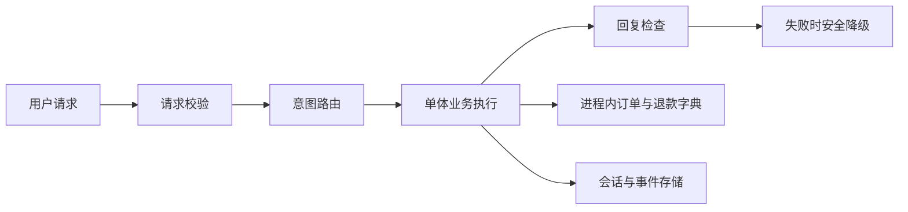
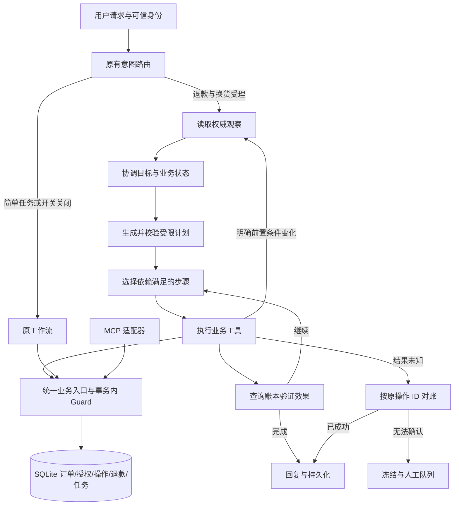

# ServicePilot 动态任务与安全恢复交付记录

日期：2026-09-24。以现有项目为基础改造，保留 FastAPI、LangGraph、意图路由、RAG 和旧流程。不引入多 Agent、长期记忆重构或新依赖。

## 已交付

| 阶段 | 修改与决策 | 实际验证 |
|---|---|---|
| A：冻结基线 | `evaluations/baselines/original_runtime.zip` 和哈希清单；保留原审计结果，旧探针通过归档重放 | 原有 64 项通过；6 个原始场景重放成功 |
| B：执行底座 | repository.py 使用 SQLite 事务账本、唯一退款、整数分金额、授权快照；policy_guard.py 在写事务内执行；agent.py 修正目标覆盖及确认话语；tool_runtime.py 禁止退款异常盲重试 | 阶段中原 64 项仍通过；新增并发、回滚、授权与重启测试 |
| C：状态与规划 | planning.py 定义 TaskState/TaskPlan/PlanStep、候选计划校验、目标检查与状态协调；dynamic_runtime.py 接入原 LangGraph 主图；默认使用受限模板 | 中间 103 项通过；最终扩展至 109 项 |
| D：恢复与入口一致性 | recovery.py 分类和查询恢复；共享 MCP 数据库；HTTP 可选 bearer 身份绑定；人工队列与运维恢复命令 | 共享 MCP 账本、身份伪造、查询失败、假成功结果、政策失败测试通过 |
| E：实验与文档 | 隔离 B0–B4 + SAFE 强基线；四篇论文适配；运行、迁移边界与本报告 | 6 组 × 9 场景 × 3 次，共 162 次执行 |

任务版本、未执行步骤失效和历史均持久化。已完成写操作不会被重规划撤销；未知结果不生成新操作 ID 重试。敏感提交使用订单、用户、金额及版本绑定的授权，旧流程也调用同一安全后端。

候选计划生成器可配置为 DeepSeek/Chat Completions JSON 模式，并经过本地验证；本次没有执行在线模型调用。首期计划限定为订单读取、政策检索、退款申请/核验工单三步骤，不支持任意工具编排。

## 架构变化

原架构：

改造后：

## 最终验证

- `.venv/bin/python -m pytest -q`：**109 passed，1 warning，2.46 秒**。包含原有全部 64 项；唯一警告仍是 Starlette/AnyIO 弃用提示。
- `.venv/bin/ruff check src tests`：通过。
- 真实服务启动：临时本机回环端口、临时数据库，GET `/api/health` 返回 ok，POST `/api/chat` 两轮完成确认并创建 REF-0001。测试结束后服务已停止。
- 原始探针可通过 `docs/research/assessment_probe.py` 重放，使用冻结代码而不是改造后的实现。
- 20 条困难业务样本：冻结原版 **9/20**，升级后旧路径 **9/20**，逐项通过/失败一致，未修改样本或放宽断言。
- 48 条困难意图样本：离线准确率 **37.5%**。本次没有更换路由模型，不能宣称解决了自然语言理解问题。
- 24 条困难检索样本：BM25 Recall@3 **0.7708**；离线 Hybrid RRF **0.6875**。原始输出保存在 upgrade_retrieval_challenge.json。没有全面重构 RAG。

## 隔离对照实验

结果来自 `evaluations/results/dynamic_ablation.json`。9 种场景为普通目标切换、带确认的目标切换、成功后响应丢失、跨轮状态变化、写入前状态变化、跨轮金额变化、写入前金额变化、结果未知、简单查询。每种重复 3 次，非随机真实业务分布。

| 组 | 定义 | 达成预定结果 | 失效授权/前置条件下提交 | 旧目标错误执行 | 重复退款记录 |
|---|---|---:|---:|---:|---:|
| B0 | 冻结原版 | 9/27 | 12 | 3 | 0 |
| B1 | 原版 + 只观察的结构化状态记录 | 9/27 | 12 | 3 | 0 |
| B2 | 动态模板计划与持久化后端；实验中关闭新增版本谓词及结果对账 | 21/27 | 3 | 0 | 0 |
| B3 | B2 + 结果对账 | 24/27 | 3 | 0 | 0 |
| B4 | 完整版本谓词与动态执行 | 27/27 | 0 | 0 | 0 |
| SAFE | 新安全恢复底座 + 原工作流 | 27/27 | 0 | 0 | 0 |

B0/B1 的去重原本就使该组测试没有重复退款记录，不能把它写成“从有重复变为无重复”。其问题是重复调用、过期授权与错误报告执行结果。

B2 同时引入了新后端，因此 B2−B1 不能单独归因于规划。B3/B4 只在隔离评测进程中调整新增版本谓词；未删除原本的归属、确认与资格规则。生产配置没有安全旁路。

B4 与 SAFE 在这组场景上都达到 27/27；B4 平均延迟约 9.34ms，SAFE 约 5.06ms，平均工具调用数均约 4.56。该计时是本机模拟器、规则路由和模板计划，不含线上模型及真实网络；全部实验 LLM Token 为 0。它说明尚无证据支持规划带来额外成功率收益，且新增编排存在开销。

所有失败和成功场景均保留消息、工具事件、实际退款调用记录、最终订单以及新后端数据库内容。B0/B1 不存在业务数据库，明确记录 ledger=null。

## 尚存边界

- 这是可靠执行的本地模拟实现，未接入真实退款/支付渠道；远端适配器须实现服务端幂等、条件写入与操作查询。
- 首期为单会话单动态售后任务；已提交退款后的新目标转人工，不做撤销或真实换货履约。
- 原在线路由使用 Responses 兼容协议；新增规划器使用 Chat Completions。真实 DeepSeek 的模型质量、Token 成本、延迟尚未验证。
- 人工接管已持久化，但没有对接客服工作台或通知系统。可用 operations 命令查看待办。
- 同一会话串行化，不提供在已开始提交的事务中实时抢占；异常退出遗留锁需要确认原进程停止后显式释放。
- 只通过本地受信 API 修改业务记录；SQLite 连接不是面向公网的业务服务。HTTP 未配置 AUTH_TOKENS 时仍为演示身份模式。
- 新增路径对缺失/失败的政策检索关闭执行；任意自然语言政策之间的语义冲突检测未实现，资格仍以现有确定性规则为准。
- 未引入 LangGraph checkpointer；任务恢复来自持久化任务表和业务操作账本。论文适配不是完整论文复现。

运行入口与配置详见 [DYNAMIC_EXECUTION.md](DYNAMIC_EXECUTION.md)。四篇论文材料、采用部分及自主设计分别见 research/REFLACT.md、REASONPLANNER.md、AGENTDEBUG.md、AGENTSPEC.md。
