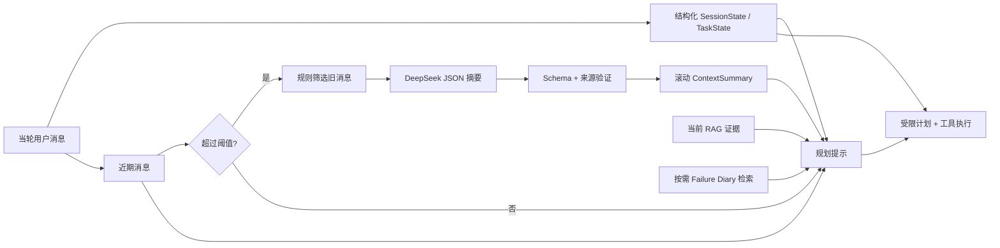

# Context Compaction：实现与 B0/B1 对照

## 触发与流向

默认关闭；在线模式设 `SERVICEPILOT_CONTEXT_COMPACTION=1` 后启用。超过 `CONTEXT_MAX_MESSAGES=30` 或 `CONTEXT_MAX_TOKENS=4000` 时触发，留下最近 `CONTEXT_KEEP_RECENT_MESSAGES=8` 条。摘要仅由更早的、经规则筛选的消息与旧摘要生成；JSON Schema 验证及逐字来源检查通过后才删除旧消息。失败不改变会话历史。

`ContextSummary` 字段为 `current_goal`、`confirmed_facts`、`completed_steps`、`unresolved_issues`、`important_constraints`、`relevant_policy_refs`、`important_tool_results`。元数据为 `summary_version`、`source_message_range`、`created_at`。订单 ID、金额、状态、授权、工具执行 ID 和版本均从结构化状态或真实工具取；摘要中的内容无法覆盖工具参数。目标变化会清空摘要。Failure Diary、历史 RAG 和 Trace 不送入摘要器。

## 12 例离线长对话 B0/B1

每例 20 轮，覆盖物流、退款确认与取消、切换订单、损坏证据、工具失败、高金额人工审核、食品与未签收政策拦截、换货工单。B0 关闭压缩；B1 用可复现的抽取式替身模型测试压缩逻辑。实验阈值为 12 条消息、4000 估算 token、保留最近 4 条，以便 20 轮内观察多次压缩；产品默认值见上文。运行：`.venv/bin/python evaluations/run_context_compaction_eval.py`。原始数据见 `evaluations/results/context_compaction_offline.json`。

| 指标 | B0 | B1 |
| --- | ---: | ---: |
| 最终任务成功率 | 100% | 100% |
| 正确工具调用率 | 100% | 100% |
| 错误订单状态引用 | 0 | 0 |
| 最终会话保留消息均值 | 33.67 | 8.67 |
| 保留文本 token 估算均值 | 405.50 | 98.42 |
| Context Bundle 估算 token 均值 | 333.34 | 211.74 |
| Context Bundle 估算 token 最大值均值 | 564.42 | 298.67 |
| 每轮本地延迟均值 | 0.43 ms | 0.43 ms |
| 摘要调用次数／例 | 0 | 3 |

离线表仅测压缩逻辑，token 为字符长度代理估算，延迟不含网络或 DeepSeek。两组最终回复、机械状态、工具及业务写入一致。

## 12 例 DeepSeek 线上摘要对照

2026-09-27 使用相同 12 例与阈值，B1 调用 `deepseek-chat` 生成摘要；B0 保持现有确定性运行路径。运行：`.venv/bin/python evaluations/run_context_compaction_eval.py --live-summary`。逐例数据见 `evaluations/results/context_compaction_live.json`。数据外发范围见 [online_egress_audit.md](online_egress_audit.md)。

| 指标 | B0 | B1 |
| --- | ---: | ---: |
| 最终任务成功率 | 100% | 100% |
| 正确工具调用率 | 100% | 100% |
| 错误订单状态引用 | 0 | 0 |
| 最终会话保留消息均值 | 33.67 | 8.67 |
| Context Bundle 估算 token 均值 | 333.34 | 224.36 |
| Context Bundle 估算 token 最大值均值 | 564.42 | 317.17 |
| 实际模型 Prompt Token 总计 | 0 | 14,795 |
| 实际模型 Prompt Token／次摘要均值 | — | 410.97 |
| 实际模型 Prompt Token／次摘要最大值 | — | 736 |
| 实际模型 Prompt Token／轮均值 | 0 | 61.65 |
| 实际模型 Completion Token 总计 | 0 | 3,993 |
| 每轮端到端延迟均值 | 0.71 ms | 136.07 ms |
| 摘要成功／失败次数 | 0／0 | 36／0 |

**结论与边界：** 在这批虚构售后任务中，压缩减少了持久会话消息和估算 Context Bundle 大小，任务结果没有下降；但 B0 原本不把完整聊天发给模型，B1 新增的 DeepSeek 摘要使**真实 Prompt Token 和延迟上升**。因此不能宣称本实现降低了当前系统的线上模型成本，也不应默认开启。该实验使用确定性业务 Agent，没有测量启用模型 Planner 后的 Prompt Token 差异；Failure Diary 的按需召回由独立测试覆盖，未在这 12 例中启用。若后续业务流程确实要把长期历史送入模型，应在该路径上另设 B0/B1 对照，再判断压缩是否有净收益。
