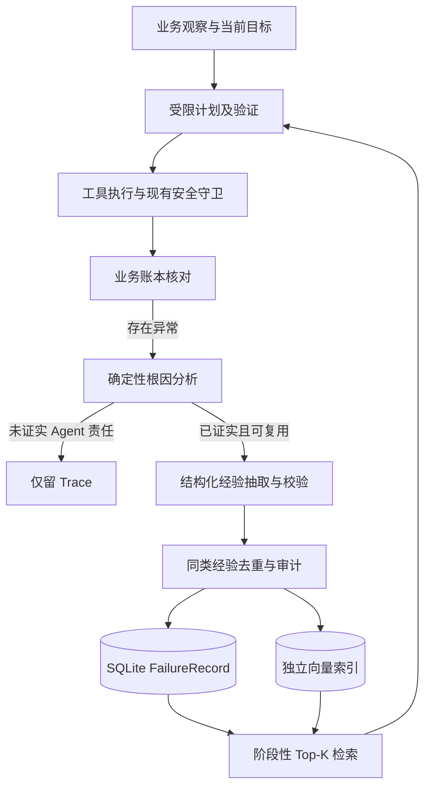

# Failure Memory 技术设计

## 研究机制与本项目适配

| 来源 | 原论文机制 | ServicePilot 采用的部分 | 本项目新增的约束 |
| --- | --- | --- | --- |
| [Reflexion](https://arxiv.org/abs/2303.11366) | Agent 对反馈作语言反思，将反思保存在 episodic memory，后续尝试以文本上下文使用，不更新权重。 | 失败后提炼简短经验，在相似任务中作为决策上下文。 | 必须有非模型证据证明 Agent 根因；不从一次自述直接写入。 |
| [ExpeL](https://arxiv.org/abs/2308.10144) | 从训练任务轨迹提炼自然语言 insight；推理时检索 insight 和过往经验，可跨任务迁移。 | 从具体订单轨迹抽象为工具/条件层面的经验。 | 经验只在满足适用条件的阶段召回，并设置版本和失效条件。 |
| [AgentDebug](https://arxiv.org/abs/2509.25370) | 分类 Agent 错误、定位级联错误的根因，生成针对性修正反馈；其 AgentErrorBench 来自 ALFWorld、GAIA、WebShop 的带标注轨迹。 | 先定位首个有证据的 Agent 偏差，再产生纠正经验。 | 用售后业务规则、授权账本和操作状态优先做确定性判定。论文分类不直接充当本项目的标签真值。 |

## 数据流

长期真实来源为独立 SQLite 表。向量集合只存索引文本和 `failure_id`，损坏时可从 SQLite 重建；政策向量集合不能混用。默认禁用在线模型提炼时，可使用经过审查的确定性经验模板；模型不可覆盖已验证的根因和证据。

## 失败分类与资格

`PLANNING_ERROR`、`GOAL_DRIFT`、`STALE_STATE`、`TOOL_SELECTION_ERROR`、`TOOL_ARGUMENT_ERROR`、`TOOL_EXECUTION_ERROR`、`EXECUTION_UNCERTAIN`、`RETRIEVAL_INSUFFICIENT`、`POLICY_CONFLICT`、`PERMISSION_ERROR`、`DUPLICATE_SIDE_EFFECT`、`SYSTEM_ERROR`。

| 类型 | 根因判据 | 可自动写入？ |
| --- | --- | --- |
| PLANNING_ERROR | 候选计划被本地受限验证器拒绝 | 可，须保留验证器事件 |
| GOAL_DRIFT | 目标版本变化后仍执行旧计划 | 仅有独立目标版本断言时 |
| STALE_STATE | 订单快照变化后仍沿用旧计划 | 仅有独立订单版本断言时 |
| TOOL_SELECTION_ERROR | 已调用意图白名单外工具 | 仅有工具白名单断言时 |
| TOOL_ARGUMENT_ERROR | 参数违反业务 Schema | 仅有 Schema 验证器断言时 |
| TOOL_EXECUTION_ERROR | 工具自身返回失败 | 默认否，需另外证明 Agent 根因 |
| EXECUTION_UNCERTAIN | 写操作结果暂未知 | 否，先查询原 operation ID |
| RETRIEVAL_INSUFFICIENT | 政策 oracle 证明漏检，Agent 仍确定答复 | 仅有双重证据时 |
| POLICY_CONFLICT | 使用失效政策版本 | 仅有版本断言时 |
| PERMISSION_ERROR | 缺少或不匹配授权 | 默认否，可能是正确守卫 |
| DUPLICATE_SIDE_EFFECT | 账本证明原操作已成功又提交新操作 | 可，须证明不同 operation ID |
| SYSTEM_ERROR | 基础设施错误 | 否 |

分类与资格分离。`EXECUTION_UNCERTAIN` 若由网络 timeout 触发，只是观察状态；若后续查到操作已经成功而 Agent 再次提交，根因为 `DUPLICATE_SIDE_EFFECT`。`TOOL_EXECUTION_ERROR`、`SYSTEM_ERROR`、`PERMISSION_ERROR` 默认没有 Agent 责任。`RETRIEVAL_INSUFFICIENT` 只有在独立政策 oracle 证明有必要政策、而 Agent 仍给确定答复时才可入库。用户取消、第三方偶发错误、模型自述和仅有最终失败状态一律不入库。

一个记录至少要有：任务/Trace 引用、失败类型、根因、失败步骤、观察与期望差异、纠正动作、可迁移经验、适用和失效条件、严重度、置信度、证据引用、状态、重复次数、使用后效果。`evidence_refs` 要指向可核验的断言或账本记录；不能把用户原始订单内容写入经验索引。

## 资格、抽取和污染防护

1. 分析器接受 Trace、`TaskState`、计划、工具记录、最终账本状态及已知断言。先查完整性和外部证据，再定位第一个违反已知规则的动作；最终回答文本不能作为唯一输入。
2. 对已验证失败，抽取器生成结构化短经验：触发条件、应该做的动作、例外条件。模型输出需过 Pydantic Schema、长度和敏感实体检查；若失败则不入库。模型不得把错误原因从 `PLANNING_ERROR` 改为别类。
3. 入库前按失败类型、工具和经验相似度去重。合并只增加次数、时间及新证据引用；经验文本、条件和根因不被自动覆写。重要变更另记审计版本。
4. 检索先过滤 `active`、任务/工具、政策与工具版本、失效条件和最低置信度，再按相似度、阶段匹配、新鲜度和历史效果排序。默认 Top-K=3，最多 5。对副作用阶段，低置信度经验不进入上下文。
5. 召回只返回 lesson、why_relevant、applicable_stage、evidence、memory_id。Planner/工具恢复逻辑仅把它视为提示；授权、政策、当前订单状态始终重新核验。
6. Trace 记录 `FAILURE_DETECTED`、`FAILURE_CLASSIFIED`、`FAILURE_MEMORY_CREATED/MERGED/RETRIEVED/APPLIED/INVALIDATED`，记录 score、原因、是否实际使用及任务结果。当前 Trace 清理策略要求长期效果统计另存 SQLite。

## 接入顺序

先部署独立存储和只读检索，再在动态规划路径的规划前、工具前与恢复时接入。上线前先以 shadow 模式记录候选召回，不注入模型；对安全与任务成功指标无回退后才启用 Planner 上下文。外部副作用调用仍保持单次提交与 operation ID 对账，不允许经验触发自动重试。

## 评测设计

三个同模型、同任务顺序、同种子、同工具/政策快照的组：B0 不使用记忆；B1 保存每次反思并全量注入；B2 验证根因后结构化存储和按需召回。每组含先发生的训练失败与后续不同订单的同类任务。按失败模式分层统计，不能把同一订单的重试计作独立样本。

在三组主对照之外，消融实验分别关闭 B2 的语义排序、适用条件过滤、去重合并和资格验证，每次只改变一个因素；最后一项仅在隔离评测环境运行，不能进入线上路径。所有消融组使用与 B0/B1/B2 相同的配对任务，并单独报告指标。当前代码提供主对照路径与汇总器，消融开关和真实任务结果仍需在评测环境补齐，不能把单元测试算作消融结果。

场景包括同类失败复现、相似但不同订单、同工具不同根因、失效经验、无关经验、冲突经验。每次试验保存独立业务断言、使用的 memory ID、token、延迟、工具调用和重规划次数。主要指标 `Repeated Failure Rate = 已记录某类失败后，同类后续任务再次出现该已验证 Agent 失败的任务数 / 此类后续任务数`；另报任务成功率、首败后同类成功率、无效召回率、错误经验使用率、平均注入数、token、延迟、工具和重规划次数。配对任务比较及置信区间必须随样本量一同报告；不要从少量 Demo 宣称有效。

公开 Benchmark 使用独立 adapter，优先检查 [AgentDebug 的 AgentErrorBench](https://github.com/ulab-uiuc/AgentDebug) 是否有可直接运行的标注轨迹，再考虑 [τ-Bench Retail](https://github.com/sierra-research/tau-bench)、WebShop 或 ALFWorld。公开任务与 ServicePilot 售后任务各自计算，不合并为一个改善百分比。若未接入公开任务，报告应明确标记未执行。

## 当前能力边界

现有确定性计划和安全守卫已避免不少目标漂移与重复副作用；这些测试中的安全恢复不应伪装成 Failure Memory 带来的收益。严格 B0/B1/B2 在线效果需要可控失败注入、模型访问和独立 oracle；代码级单元测试只能证明资格、存储和检索逻辑，不能证明重复失败率改善。
