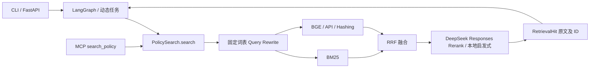

# 可插拔决策 RAG：实际架构审计

审计日期：2026-09-24。修改核心行为前，已用 `evaluations/baselines/jev_stage1` 的四个原始模块在隔离目录重跑 24 条冻结样本，每组重复三次，结果见 `evaluations/results/pluggable_rag/original_offline.json`。这是 Hashing 离线基线，不是 DeepSeek 在线效果。此前真实 BGE + DeepSeek 的 24 条在线原始基线保存在 `evaluations/results/jev_stage1/b0_online.json`：Recall@5=1.0、MRR=0.9583。此次未重复消耗其已用完的 25 次预算。

- 构造入口是 `cli.build_agent` 与 `mcp_server`，调用面仍为同步 `PolicySearch.search`。LangGraph 经原有节点包装器传递原始问题及必要订单条件；模型不接收订单 ID、地址、支付信息。
- `retrieval.py` 的 AdvancedHybridPolicyRetriever 并行 BM25 / Vector，原始及改写查询融合。candidate_limit=12、RRF 常数=60、最低分=0.01，缓存默认 300 秒。原始模式与参数保持不变。
- `providers.ResponsesPolicyReranker` 使用共享 `UrllibJsonTransport.post('/responses', …)`，结构化 ordered_policy_ids，解析失败由检索器回退原候选。已实测当前 DeepSeek 端点支持此协议，不凭推测改端点。
- 原 Query Rewrite 是固定同义替换，没有条件式证据充分性判断。已有 Jev 实验的有界纠错循环最多两次补检索，但它绑定 Jev Key、Jev 校准和完整政策日期，不能满足本次要求。
- 现有政策 JSON 未提供来源、版本和生效日期。不能编造这些字段。新路径仅信任启动时加载的本地政策对象快照；显式来源/日期/类别仍按规则校验，缺省日期保持未知，不声称法律或业务有效性已经验证。
- 检索不授予退款权限。动态任务对空证据转人工，静态旧调用并非所有路径都安全处理空证据，故保持原兼容回退；完整纠错安全路径用于动态任务及显式 async retrieve。
- Trace 已有 SQLite、contextvars、模型真实 usage、Span/Event 和 Viewer。本次沿用，不新增存储系统。已有 159 个测试；Python 3.11、Pydantic 2.13.5、jev-reranker 0.1.2（可选）实测安装。
- 冻结困难集 24 条、常规集 35 条；新增复杂证据集与冻结集分离。聚合器未观测的成本/回答正确率保持 null，不能由召回率推断回答正确性。

新架构在 RRF 后增加统一评分接口，B1 仅评分，B2 增加充分性判定，B3 开启有界补检索；原始 B0 不改。Jev 是明确不可用的未来适配器，测试替身不代表真实集成。DeepSeek 不依赖 Jev 密钥、SDK 或校准文件。相关性评分先不按阈值删除候选，未来阈值必须分 provider 校准。
