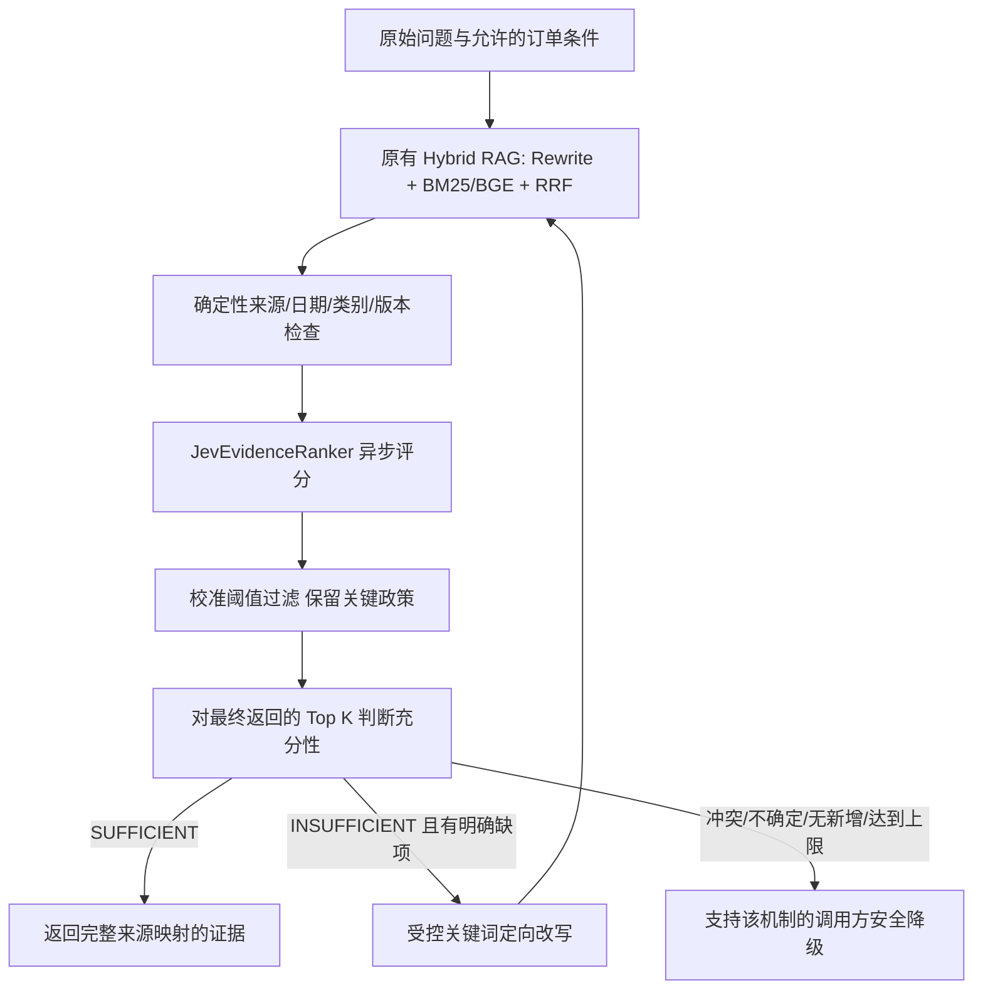

# Jev 自纠错 RAG：实现与使用

## 当前交付状态

已完成可插拔异步 Jev 评分、过滤校准验证、四态充分性候选判断、有界定向检索、上下文与 Trace 集成、评测汇总和故障测试。默认 `original` 路径保持原行为。实际安装并检查 `jev-reranker==0.1.2`，依赖锁文件已更新。

本轮没有 Jev 实网调用。未取得真实 Jev 分数分布、充分性可靠性和 B1–B3 效果，因此过滤和纠错仍是受门槛控制的实验功能，不能宣称速度、成本或准确率提升。已有 B0 结果完整保留。

## 结构与代码



- `jev.py`：已安装第三方库的 `a_rerank` / `a_relevance_rerank`；官方结构化决策协议的轻量 HTTP 适配。每次真实 HTTP 请求创建 LLM Span，父评分节点不重复计为模型调用。输入输出只记录脱敏摘要，SDK detail 不整包入库。
- `evidence.py`：请求上下文、允许的订单条件、元数据校验、四态判断。Jev 仅是候选充分性评估器，不决定退款授权。
- `evidence_calibration.py`：从逐条评分重新计算阈值与验证门槛，拒绝只提供一个阈值或一项 validated=true 的配置。
- `corrective_rag.py`：原 search 接口与异步接口；最多两次重新检索，失败不重试敏感工具。同步入口不能在运行中的事件循环中调用，异步服务使用 asearch/retrieve。
- `rag_evaluation.py`：汇总 B0–B3 观测，缺失 Token、费用、答案评判保持 null，并单列错误过滤关键证据的案例。
- `models.py` / `retrieval.py`：PolicyChunk 增加可选 source/version/effective_from/effective_to，加载器读取；旧数据不伪造默认权威来源或业务版本。
- `cli.py` / `mcp_server.py`：选择检索模式；保留原 DeepSeek 重排作默认和适用的失败降级。
- Agent/Graph 的入口装饰器及统一节点包装器只传递原始问题、类别和签收天数，不改规划、记忆或商务工具决策。没有新增 Agent。

## 配置与启动

安装现有组件和新可选依赖：

```sh
uv sync --extra api --extra agent --extra dev --extra jev
```

所有凭证仍通过环境变量提供，不提交到仓库；不要把密钥发到聊天或写入评测文件。

| 配置 | 默认 | 作用 |
| --- | --- | --- |
| SERVICEPILOT_RAG_MODE | original | original / jev_rerank / jev_filter / jev_corrective |
| TYPESAFE_API_KEY | 无 | 用户自行配置的 Jev 凭证 |
| SERVICEPILOT_JEV_MODEL | jev-latest | 校准 artifact 必须匹配；实测后应锁定可用的具体模型版本 |
| SERVICEPILOT_JEV_SCORING_MODE | listwise | listwise 或 pointwise，切换须重新校准 |
| SERVICEPILOT_JEV_TIMEOUT | 8 秒 | 每次评分/决策的整体等待上限，含等待并发槽位 |
| SERVICEPILOT_JEV_CALIBRATION | 无 | 独立实网评分与充分性验证的 artifact 路径 |
| SERVICEPILOT_POLICY_SOURCES | 无 | 审核过的政策 source 标识，以逗号分隔 |
| SERVICEPILOT_RAG_MAX_CORRECTIONS | 2 | 0–2，首次检索之外的纠错次数 |

`original` 不创建 Jev 客户端。`jev_rerank` 保留全部候选，只排序；模型评分异常回退原 DeepSeek 重排或原候选顺序。`jev_filter` 需要有效校准材料；全被过滤时，兼容旧接口的 rerank 会退回原排序并记录降级，避免不支持空证据的旧分支继续产生无依据答复。

`jev_corrective` 需要校准、独立充分性验证、可信来源及有业务版本/日期的政策。现有 production policies.json 未补写这些未经核实的字段，所以当前语料不能直接进入纠错生产路径。不得为通过门槛批量填造来源和生效日期。

已适配动态任务中原有“空证据→安全降级”路径，以及只返回文档的 MCP search_policy。其他旧业务处理器仍保留 original 检索，Trace 记录 `unsupported_safe_empty_path`，不假设它们已有证据失败拦截。公开 `retrieve(..., context=EvidenceContext(...))` 可用于研究及异步服务，调用方必须检查 judgment。

## 评分、充分性与纠错语义

第三方库始终以 threshold=0、top_k=None 返回全量分数。适配器严格校验数量、索引唯一性与范围、有限 0–1 分数，然后映射回原 RetrievalHit，保留原政策对象和 Metadata。相同正文不会导致来源交换；重复 ID 必须先做版本核对。

Jev 请求包含原问题、必要条件和候选 ID/来源/版本/正文，不包含订单金额、地址、用户凭证。最终 Trace 只保留评分、ID、耗时和允许保存的摘要。缺失 API 用量/费用为未知；不按本地字符数估算 Token。官方返回的概率与置信度都校验，不把 Noul 概率冒充答案正确率。

独立充分性判断使用 Choice 四态，另对适用条件及问题涉及的质量例外、退货条件、退款到账等维度提问。高相关性不代表充分性；只检查实际将返回的 Top K，不能用被截掉的文档为结果背书。缺少明确的签收天数、无原问题、低置信度或结构异常均保守处理。

先用确定性规则排除非可信来源、未知/失效日期、类别不匹配证据；同一 policy_id 的同时有效不同版本或不同正文直接判冲突，不任意选择版本。其他语义冲突交给候选判断，未解决时不释放证据。当前没有网页搜索，不将互联网内容作为售后执行政策。

只有 INSUFFICIENT 且有明确缺项才重检索。缺项映射到固定领域查询词并保留原问题，不假定 Jev 能自由生成文本。没有新增有效 Top K 证据时，在再次询问模型之前停止，避免靠重复提问等到“充分”答案。不同订单条件不会复用评估结果：实验路径不缓存模型评分/充分性，候选缓存 TTL 设为 0；original 的缓存配置不变。

每个 backend 最多两个并发实际 HTTP 请求，跨 listwise/pointwise 批次共享限制。第三方自动重试为 0；取消会传播，调用超时会降级。最多两轮纠错不是全请求 8 秒期限：每一轮可能有一次评分和一次充分性调用，pointwise/分块还会增加真实 HTTP 数；必须按 Trace 的实际请求统计成本。

## 校准 artifact 与上线门槛

artifact 需要以下字段：`artifact_id`、`source=jev_live`、`corpus_sha256`、`model`、`config_version=servicepilot-evidence-v1`、`scoring_mode`、`library_version=0.1.2`、`confidence_floor`、`observations`。

每条 observation 包含 case_id、policy_id、score、relevant（布尔）、critical（布尔）。必须至少 20 个独立校准 case，有正负证据、至少三种关键政策，case ID 不得与原冻结 24 题重叠。阈值逐项扫描，要求关键证据保留率 100%、相关证据保留率至少 98%，校准中标为关键的政策 ID 额外保护。报告应保留低分关键证据和错误过滤样例。

纠错模式另需 `sufficiency_config_version=sufficiency-v1` 和 `sufficiency_validation`：至少 20 个独立、与校准和冻结测试不重叠的案例，覆盖四态，每条有 expected/predicted；准确率至少 90%，不能出现将非充分误判为充分的案例，confidence_floor 不低于 0.9。

这是保守的工程放行规则，并非已取得的评测成绩或统计保证。artifact 的真实调用来源仍需由实验者核对；一个 JSON 中写 source=jev_live 不构成密码学认证。禁止把测试中的合成 artifact 当成生产校准。模型、模式、提示配置或语料变化后必须重跑；同名浮动模型的供应商升级也需重新验证。

## 测试、数据与实验结果

```sh
.venv/bin/python -m pytest -q
.venv/bin/ruff check src tests
.venv/bin/python -m servicepilot.rag_evaluation \
  --cases evaluations/retrieval_challenge.json \
  --runs evaluations/results/jev_corrective/observed_runs.json \
  --output /tmp/servicepilot-ablation.json
```

新增 `tests/test_corrective_rag.py` 覆盖真实安装库+Mock HTTP 的评分接口、官方决策协议、实际请求 Span/usage、取消、超时、无重试、并发上限、异常评分、ID 映射、来源和版本冲突、缺条件、充分性低置信度、错误过滤、无新证据停止、纠错上限、跨订单隔离、原路径身份保持及校准 gate。Mock 只证明工程行为，不证明 Jev 模型质量。

新增六条带可接受答复、必要条件、关键政策和禁止承诺的研究样本，位于 `evaluations/corrective_rag_cases.json`，覆盖普通、特殊质量条款、缺证据、多政策、版本冲突及噪声。版本冲突使用测试构造的双有效版本 fixture；并未把假政策写入真实语料。原冻结 24 题和标签未改。

消融状态见 `evaluations/results/jev_corrective/ablation_status.json`：B0 为上一轮 24 题真实 DeepSeek 结果，Recall@5=1.0、MRR=0.9583；B1/B2/B3 全部 not_run，指标 null。最终答案准确率和无依据承诺次数也未知；现有业务没有统一生成模型，不能从检索命中推导答案指标。后续应在相同候选快照上运行真实 Jev，新增评测需要单独控制调用预算和费用。

原始 B0 的四个检索相关源码文件备份至 `evaluations/baselines/jev_stage1/`，逐个 SHA256 与阶段一 manifest 匹配。升级后旧在线脚本会拒绝当前源码冒充 B0；复测应复制项目到隔离目录，用这四个冻结文件覆盖对应 src/servicepilot 文件，再执行该隔离项目的基线脚本。不要在工作项目中覆盖新实现，也不要改旧基线参数。
