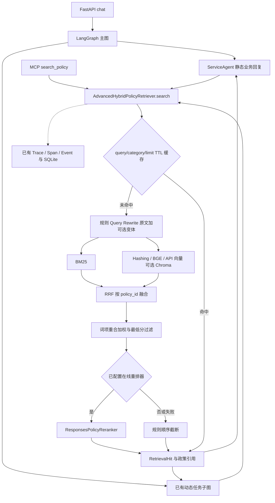

# 阶段一：RAG 代码审计与原始基线

后续进展见 [在线基线补充](jev_stage1_online_followup.md)：本地 BGE 与在线接口已恢复可用，下文在线阻塞描述保留为首次审计时的状态。

审计日期：2026-09-24。仅新增研究文档和评测脚本/结果，生产 `src/servicepilot`、冻结题目、政策、规划、记忆和工具安全逻辑未改动。

## 真实架构



## 代码定位和关键事实

| 模块 | 当前实现及影响 |
| --- | --- |
| `cli.py:build_agent` | 默认 HashingTextEncoder；online 才接 ResponsesPolicyReranker，模型复用 intent_model。embedding_mode 支持 api/local/hashing，local 默认 BAAI/bge-small-zh-v1.5。不能把默认路径标成 BGE+DeepSeek |
| `retrieval.py:BM25PolicyRetriever` | k1=1.5、b=0.75，既有中文词项切分，类别不匹配排除、无类别文档视作通用 |
| `FastEmbedTextEncoder/VectorPolicyRetriever` | BGE 用 FastEmbed/ONNX，向量归一化；默认哈希 256 维不具有 BGE 语义能力 |
| `ChromaPolicyRetriever` | 可选持久向量库；查询后按 category 过滤，有限 overfetch 不能保证补满 K；没有有效期校验 |
| `QueryRewriter` | 每次未命中缓存时执行六条固定替换，如“钱没到→退款到账时效”；有变化则原文+变体，不是模型推理或缺证据触发 |
| `AdvancedHybridPolicyRetriever.search` | 每个变体并发 BM25/向量，最多 4 线程；每路候选 12；RRF 常数 60；按 policy_id 合并，再加 0.02×词项重合；最低分 0.01 |
| `providers.py:ResponsesPolicyReranker.rerank` | POST /responses，发送 query 与候选 ID/标题/正文，要求 JSON ordered_policy_ids；中文指令要求直接相关及多政策齐全；移除重复/未知 ID，遗漏候选补回，分数改为 1/rank。它不是独立证据充分性判断 |
| 失败处理 | 单召回源失败保留另一路；重排失败退回规则排序；没有纠错循环，也没有证据冲突判断 |
| 缓存 | 进程内字典，键 (query,category,limit)，TTL 300 秒、容量 256，过量删除最早过期项；没有订单条件、政策版本、模型/指令版本；降级结果也缓存 |
| 调用入口 | agent.py 多处同步 search；dynamic_runtime.py 使用固定退款/换货短语、类别和 limit=3；MCP 有独立检索实例，未启用在线重排 |
| 返回与回答 | RetrievalHit 包含 PolicyChunk、score、matched_terms；上层取 policy_ids 作为引用，动态任务步骤保存 policy_ids。现有主要回复由业务代码构造，没有统一的 DeepSeek 最终生成节点 |
| 元数据 | PolicyChunk 只有 ID、标题、正文、categories、tags；缺官方来源、政策版本、生效/失效时间。Trace 内容摘要不等于业务政策版本 |
| 动态规划与 Trace | 均已实现；主图/子图、模型、RAG 召回/重排和工具已有 Span；支持上下文传播、SQLite、鉴权查询/查看页。本次应复用 |

## 审计风险与后续约束

- 固定检索短语丢失用户的“拆封、超期、质量问题”等细节，单纯插入 Jev 不能恢复这些条件。
- 当前空结果在动态路径已有安全降级，但现有非空结果不代表充分依据；新增评估不能把最高分等同于充分性。
- 版本冲突校验缺必要元数据；后续需在 RAG 数据模型中明确缺失语义。
- 缓存与 `last_diagnostics` 是共享可变实例状态；Trace 上下文隔离不代表诊断字段或缓存已经并发安全。新模块不能将该字段当作每请求唯一结果。
- `as_completed` 的结果插入顺序可能影响同分候选，未来对照必须冻结实际候选顺序。本轮三次结果一致，不代表无潜在竞态。
- 原重排器吞掉异常后返回候选，若只看 Recall 可能把全量在线降级误写成模型结果，评测必须检查失败率和实际调用记录。

## 样本与基线冻结

既有 `evaluations/retrieval_cases.json` 共 35 题；冻结困难集 `retrieval_challenge.json` 共 24 题，覆盖口语改写、多政策、负例、错字。原评测 `retrieval_evaluation.py` 默认 K=3，提供 Recall/MRR/nDCG/零命中率和切片；不提供耗时、Token 或成本，也不评价最终答案。

本轮保留 K=3 并补测 K=5，没有调整候选数量、融合常数、过滤分、缓存参数、语料或标签。原脚本输出保存在 `evaluations/results/jev_stage1_offline_k3.json`。新增脚本 `scripts/jev_stage1_baseline.py` 保存数据/源码 SHA256、包版本、每题预测、三轮冷缓存结果、候选 ID/顺序/分数/内容摘要及耗时分布。候选记录器只是原顺序截断，并逐轮对比原实现的全部预测，验证等价。

计时边界是 `search()`，包括检索、排序及 Span 采集，不含索引初始化、Trace 结束刷盘、HTTP 或完整对话。每组 24 题×3 次；每次重建检索器保持查询缓存冷态。不是线上吞吐或延迟承诺。

| 离线组 | Recall@3 | MRR@3 | Recall@5 | MRR@5 | K5 mean/P50/P95 ms |
| --- | ---: | ---: | ---: | ---: | --- |
| bm25 | 0.7708 | 0.6875 | 0.8125 | 0.6875 | 0.113 / 0.110 / 0.153 |
| hashing_vector | 0.5208 | 0.5139 | 0.5833 | 0.5243 | 0.279 / 0.269 / 0.276 |
| hybrid_rrf | 0.6875 | 0.6111 | 0.7083 | 0.6111 | 0.415 / 0.414 / 0.459 |
| hybrid_rewrite_heuristic | 0.6875 | 0.6111 | 0.6875 | 0.6111 | 0.833 / 0.807 / 0.978 |

规则重排阶段 K5 mean/P50/P95：0.022/0.022/0.025 ms。全部离线组实际远程调用为 0，因此本轮远程 Token 和 API 费用均为 0；这不能用于估计 B0/B1 的模型用量。

结果没有显示混合检索必然优于 BM25。当前默认混合策略 Recall@5=0.6875，低于 BM25 的 0.8125；扩大最终 K 并没有改善默认混合组召回，说明前序候选/筛选也需要在后续固定条件下分析。未为改善结果修改参数。

## 在线 B0 的状态与历史结果

项目本地配置存在 DeepSeek 凭证，base_url 指向 api.deepseek.com、模型 deepseek-flash、embedding_mode=local；本报告不记录密钥。当前环境未直接加载这些变量，应用启动需要显式注入。默认 BGE 缓存离线加载失败，FastEmbed 0.8.0 已安装；未下载模型或用哈希冒充 BGE。

一次受限环境原接口预检得到 URLError、无 HTTP 状态；不能据此判断供应商是否支持 /responses。申请联网执行同一预检被自动审批拒绝，理由是向第三方发送样本/政策内容尚缺明确外发授权。已向用户说明并请求授权；未绕过拒绝。原始记录见 `evaluations/results/jev_stage1/online_preflight.json`。B0 的真实 Recall、重排耗时、Token 与成本本轮均未获得，应标为 null/未完成。恢复后先做 1 次预检，再最多完成 24 题、无重试，失败即停；不能默默改成 Chat Completions 后仍称原实现。

仓库历史 `retrieval_challenge_semantic_llm.json` 声称 BGE+Responses 重排 Recall@3=1.0、MRR=1.0，但缺本轮可复现的运行环境、耗时和用量证据，单列历史参考，不冒充新实测基线。历史 JSON 没有费用数据，不能推算真实账单。

## 本轮验收与下一阶段条件

原有 127 项测试全部通过（1 条依赖弃用警告）。新增离线脚本及原有代码通过 Ruff；候选捕获与原始实现预测等价，三次排名一致。阶段一代码审计、研究、离线基线已完成，在线原始 B0 仍缺外发授权及本地 BGE 模型；因此不声称阶段一的在线基线完整完成，也未启动 B1–B3 或生产接入。

复现命令（项目根目录，无远程请求）：

```sh
.venv/bin/python -m servicepilot.retrieval_evaluation \
  --cases evaluations/retrieval_challenge.json \
  --output /tmp/servicepilot-baseline-k3.json
PYTHONPATH=src .venv/bin/python scripts/jev_stage1_baseline.py \
  --output /tmp/servicepilot-stage1-profile.json
.venv/bin/python -m pytest -q
.venv/bin/ruff check src tests scripts/jev_stage1_baseline.py
```

后续 B1–B3 的关键证据保留、错误证据过滤、充分性准确率、答案正确率、无依据承诺次数均未测；冻结集目前也没有完整答案/充分性标注，不能由检索 Recall 替代这些指标。先新增独立标注与校准集，再锁定评判与阈值，保持现有 24 题不变。
